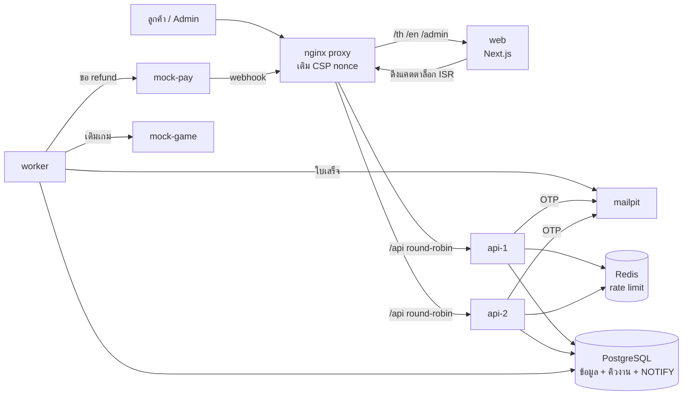
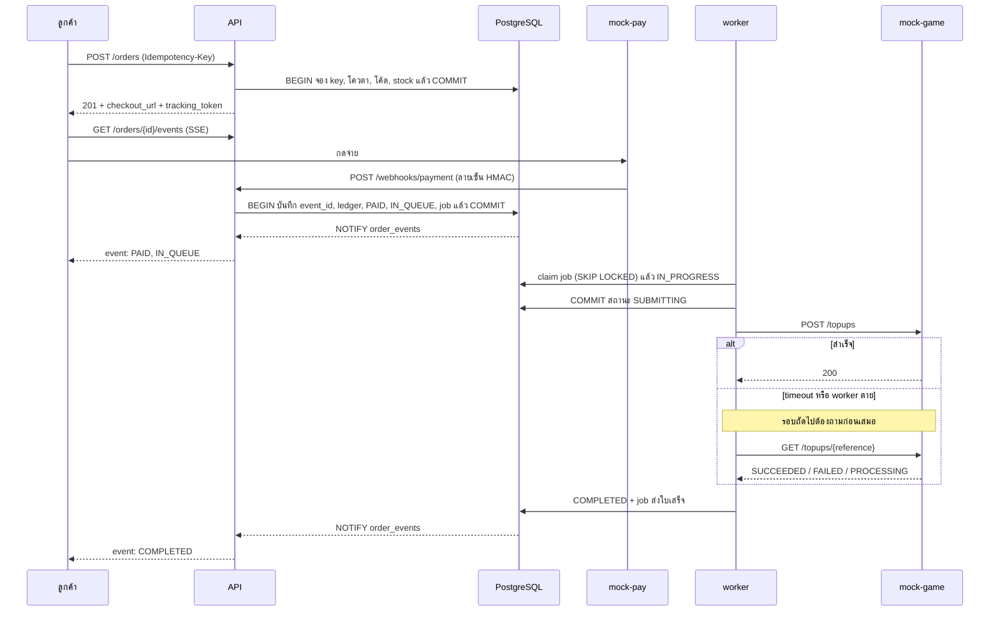
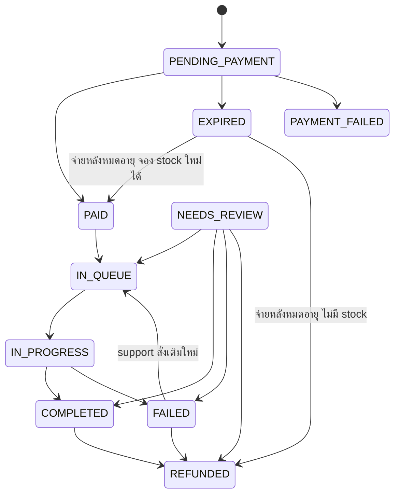

# Architecture

## ภาพรวมระบบ

หลักคิดของระบบคือ **PostgreSQL เป็นแหล่งความจริงเดียว** สถานะออเดอร์ เงิน และงานที่ต้องทำ commit ใน transaction เดียวกัน จึงไม่มีช่วงที่ข้อมูลขัดกันเอง กฎที่ห้ามผิดถูกบังคับด้วย constraint หรือ trigger ในฐานข้อมูล ไม่ได้พึ่งโค้ดอย่างเดียว

## Flow จ่ายเงินถึงเติมเกม

## State machine

เส้นทางตามแผนภาพในโจทย์ทั้งหมด บวกเส้นที่เพิ่มเพราะข้อกำหนดอื่นบังคับ (ดู [ADR-0004](docs/adr/0004-late-payment.md))

ทุกสถานะเข้า `NEEDS_REVIEW` ได้ตามข้อ 5.3 ตารางเส้นทางอยู่ทั้งในโค้ด (`app/domain/state_machine.py`) และใน trigger ของฐานข้อมูล โดยมี integration test ตรวจว่าทั้งสองตรงกัน

## การจัดการ failure แต่ละจุด

| จุดที่พัง | ผลที่เกิด | ระบบรับมืออย่างไร |
|---|---|---|
| คนซื้อพร้อมกันหลักพัน | แย่ง stock แถวเดียวกัน | `UPDATE ... WHERE stock_remaining >= n` ทำเช็กกับตัดในคำสั่งเดียว มี `CHECK >= 0` เป็นด่านสุดท้าย |
| ลูกค้ากดส่งซ้ำ หรือเน็ตหลุดหลังส่ง | สร้างออเดอร์ซ้ำ | key กับออเดอร์ commit พร้อมกัน ตัวซ้ำรอจนตัวแรกจบแล้วอ่านคำตอบเดิม |
| API ตายระหว่างสร้างออเดอร์ | งานค้างครึ่งทาง | transaction rollback ทั้งก้อน รวมถึงการจอง key |
| webhook ซ้ำ มาพร้อมกัน | จ่ายซ้ำ | primary key ของ `event_id` ตัวซ้ำรอแล้วเจอ conflict |
| webhook สลับลำดับ | สถานะย้อน | `payment.failed` หลังจ่ายแล้วถูกบันทึกแต่ไม่เปลี่ยนสถานะ |
| ยอดไม่ตรง | เติมของผิดราคา | บันทึกเงินที่ได้จริง แล้วไป `NEEDS_REVIEW` ไม่เติมเกม |
| จ่ายหลังหมดอายุ | เงินเข้าแต่ออเดอร์ตาย | จองใหม่ได้ก็เติมต่อ ไม่ได้ก็ refund อัตโนมัติ |
| worker ตายก่อนยิง POST | งานค้าง | lease หมดใน 15 วินาที งานกลับเข้าคิว สถานะ `PENDING` จึงยิงได้ |
| worker ตายหลังยิง POST | เติมซ้ำได้ | สถานะเป็น `SUBMITTING` รอบถัดไปต้อง `GET` ก่อน |
| mock-game timeout ทั้งที่เติมแล้ว | เติมซ้ำได้ | ใช้ทางเดียวกับข้อบน `GET` เจอ `SUCCEEDED` จึงไม่ยิง |
| mock-game ล่มยาว | เช็กผลไม่ได้ | ไม่ยิงซ้ำเด็ดขาด ครบรอบแล้วไป `NEEDS_REVIEW` และ dead-letter |
| PostgreSQL ล่ม | ทำงานต่อไม่ได้ | `/readyz` ตอบ 503, API ตอบ 503, worker รอแล้วทำต่อ, provider ยิง webhook ซ้ำเอง |
| Redis ล่ม | rate limit หาย | ถอยไปนับในแต่ละ replica ระบบส่วนอื่นไม่กระทบ |
| api-1 ล่ม | request ค้าง | nginx ส่งไป api-2 และไม่ replay POST ที่อาจถึงปลายทางแล้ว |
| สัญญาณ NOTIFY หาย | สถานะไม่อัปเดต | แต่ละสตรีมอ่าน DB ซ้ำทุก 1 วินาที |
| งานหายผิดปกติ | ค้าง `IN_PROGRESS` | scheduler ตรวจออเดอร์ที่ไม่มี job แล้วส่งไป `NEEDS_REVIEW` |
| finance กด refund พร้อมกัน | คืนเกินยอด | lock แถวออเดอร์ นับยอดตั้งแต่รับคำขอ และมี `CHECK refunded <= paid` |
